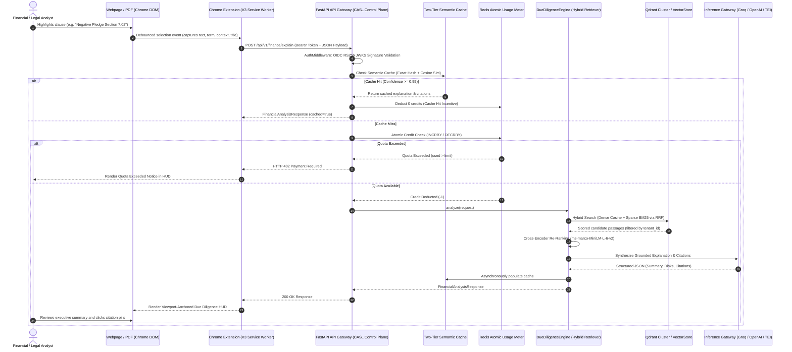

# CASL — Complete System Architecture & Engineering Blueprint

This document details the complete end-to-end architecture of **CASL (Context-Aware Smart Linker)**, an institutional B2B SaaS platform for financial and regulatory due diligence.

---

## 1. System Context & Data Flow



---

## 2. Microservice & Layer Topology

### 2.1 Layer 1: In-Situ Workspace Overlay (Chrome Extension V3)
- **Content Script (`content.js`)**:
  - Listens to `mouseup` / `selectionchange` events with sequence-debounce counter (`currentSelectionSeq`).
  - Calculates viewport-relative coordinates via `lastSelectionRect` to eliminate vertical coordinate drift on 100-page SEC filings.
  - Asynchronously pulls active `caslTenantId` from `chrome.storage.local`.
- **Background Service Worker (`background.js`)**:
  - Acts as the secure client-side proxy between the DOM and the API gateway.
  * Dynamically resolves the Gateway Ingress URL from extension storage, defaulting to `http://localhost:8000`.
  - Enforces zero client secret leakage: no bundled LLM keys.
- **Enterprise Options HUD (`options.html` / `options.js`)**:
  - Provides a secure configuration interface for analysts to specify their corporate Gateway URL, Tenant ID, and Bearer token.

### 2.2 Layer 2: API Gateway & Security Control Plane (FastAPI)
- **FastAPI Core (`backend/main.py`)**:
  - Mounts 37 modular endpoints across finance, billing, ingestion, retrieval, telemetry, and health.
  - Injects `CORSMiddleware` supporting universal web document ingress.
- **Enterprise OIDC JWT Validator (`backend/security/jwt_auth.py`)**:
  - Cryptographically verifies RS256 and ES256 signatures against Identity Provider JWKS endpoints (`OIDC_JWKS_URL`).
  - Decodes and binds tenant context (`request.state.tenant_id`) directly from validated enterprise claims (`org_id`, `tenant_id`).
- **Telemetry & Tracing (`backend/observability/tracer.py`)**:
  - OpenTelemetry auto-instrumentation exporting spans to Jaeger on port `4317` (gRPC) / `4318` (HTTP).

### 2.3 Layer 3: Financial Due Diligence Engine (`backend/domains/finance/`)
- **Structure-Aware Chunker (`parser.py`)**:
  - Preserves hierarchical structural headings (`Item 1A`, `Item 7`, `Section 8.01`).
  - Extracts regulatory stock tickers while applying stop-word suppression (`FORM`, `ITEM`, `DEBT`, `NOTE`, `INDEX`).
- **Hybrid Retrieval & Grounding (`engine.py`)**:
  - Combines dense embeddings with per-tenant sparse BM25 retrieval via Reciprocal Rank Fusion:
    $$\text{RRF\_Score}(d) = \sum_{m \in M} \frac{1}{60 + \text{rank}_m(d)}$$
  - Dispatches candidate passages to a Cross-Encoder re-ranker (`cross-encoder/ms-marco-MiniLM-L-6-v2`) inside `asyncio.to_thread`.
  - Enforces strict source citation reconciliation against indexed filing accession numbers.

### 2.4 Layer 4: Multi-Tenant Billing & Monetization (`backend/billing/`)
- **Atomic Redis Meter (`redis_meter.py`)**:
  - Utilizes atomic Redis pipeline scripts (`INCRBY` / `DECRBY`) with rolling monthly TTL keys (`casl:usage:{tenant_id}:{YYYYMM}`).
  - Enforces hard query caps by tier:
    - `STARTER`: 500 queries/mo
    - `PROFESSIONAL`: 5,000 queries/mo
    - `ENTERPRISE`: 50,000 queries/mo
- **Automated Stripe Webhooks (`stripe_webhook.py`)**:
  - Ingests `checkout.session.completed`, `invoice.paid`, and `customer.subscription.deleted` to automate quota expansions and churn downgrades.
- **Relational System of Record (`db_models.py`)**:
  - SQLAlchemy ORM schemas (`TenantAccount`, `CreditAuditLedger`) ensuring immutable historical accounting records.

### 2.5 Layer 5: Autonomous SEC EDGAR Pipeline (`backend/tasks/`)
- **Bounded Streaming Crawler (`sec_document_fetcher.py`)**:
  - Reads SEC archives in bounded 64KB stream buffers (`max_bytes=1_000_000`), protecting worker pods from Out-Of-Memory kills.
  - Strips inline XML/iXBRL formatting and isolates Item 1A (Risk Factors) and Item 7 (MD&A).
- **Celery Beat Poller (`sec_edgar_pipeline.py`)**:
  - Periodic task running every 15 minutes to ingest new public 10-K, 10-Q, and 8-K filings into the `public_markets` shared tenant partition.

---

## 3. Physical Deployment Topology (`docker-compose.prod.yml`)

```
┌────────────────────────────────────────────────────────────────────────┐
│                        DOCKER PRODUCTION NETWORK                       │
│                                                                        │
│  ┌───────────────────────┐          ┌───────────────────────────────┐  │
│  │ casl-api-prod         │          │ casl-celery-worker-prod       │  │
│  │ (FastAPI, Port: 8000) │          │ (Deep Filing Ingester)        │  │
│  └───────────┬───────────┘          └───────────────┬───────────────┘  │
│              │                                      │                  │
│              │             ┌────────────────────────┘                  │
│              ▼             ▼                                           │
│  ┌───────────────────────────────────┐  ┌───────────────────────────┐  │
│  │ casl-redis-prod (Port: 6379)      │  │ casl-qdrant-prod          │  │
│  │ • Rate limits & Atomic Metering   │  │ (Dense Vector Store)      │  │
│  │ • Celery Task Broker & Backend    │  │ Port: 6333                │  │
│  └───────────────────────────────────┘  └───────────────────────────┘  │
│              │                                                         │
│              ▼                                                         │
│  ┌───────────────────────────────────┐  ┌───────────────────────────┐  │
│  │ casl-celery-beat-prod             │  │ casl-jaeger-prod          │  │
│  │ (Periodic SEC RSS Poller)         │  │ (OpenTelemetry APM)       │  │
│  │                                   │  │ UI Port: 16686            │  │
│  └───────────────────────────────────┘  └───────────────────────────┘  │
└────────────────────────────────────────────────────────────────────────┘
```

