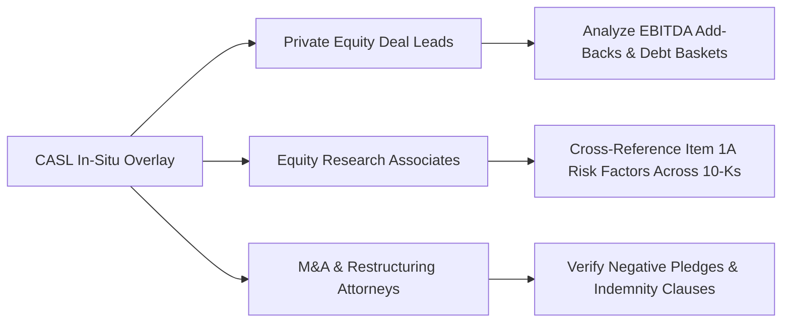

# CASL — Product Vision, Economics & Target Personas

## 1. Executive Summary: Why Vertical B2B Micro-SaaS?

CASL is purpose-built as an **Enterprise B2B Micro-SaaS** for financial, legal, and regulatory due diligence.

### Why It Fails as a B2C Tool
Consumers do not pay for SEC EDGAR indexing, multi-tenant isolation, cross-encoder re-rankers, or debt covenant analysis. Consumer queries ("What is inflation?", "Who is the CEO of Apple?") are already answered for free by generic ChatGPT or Perplexity in another tab. Building CASL for B2C leads to high churn, low willingness to pay, and negative unit economics.

### Why Enterprise B2B SaaS is the Definitive Fit
1. **The Form Factor Fits Corporate Workflows**: Financial analysts and M&A attorneys spend their entire workday reading dense prospectuses, regulatory filings, and credit agreements inside web browsers and PDF viewers. An in-situ workspace overlay saves them 5 to 10 hours of manual cross-referencing per deal.
2. **Superior Unit Economics**: Boutique hedge funds, private equity firms, and corporate legal departments easily justify **$200 to $1,000 per seat per month**. Saving an associate 5 hours of manual covenant verification pays for the entire annual license in one week.
3. **High Switching Costs & Data Gravity**: As a firm indexes proprietary deal rooms, past credit agreements, and diligence notes into their isolated tenant partition, CASL becomes an irreplaceable institutional memory repository.

---

## 2. Target Personas & Use Cases

### Persona 1: Private Equity Deal Lead
- **Reading Surface**: Target company confidential information memorandums (CIMs), credit agreements, debt indentures.
- **Pain Point**: Deciphering customized "Adjusted EBITDA" definitions across 80 pages of footnotes to detect hidden leverage risks.
- **CASL Impact**: Highlights "Consolidated EBITDA Add-Back Section 1.01" $\rightarrow$ CASL HUD immediately displays the exact definitions, caps, and historical precedents from comparable filings.

### Persona 2: Equity Research Associate
- **Reading Surface**: SEC 10-K, 10-Q, 8-K earnings releases, management commentary.
- **Pain Point**: Identifying subtle changes in risk disclosures from quarter to quarter.
- **CASL Impact**: Highlights a risk disclosure clause $\rightarrow$ CASL surfaces the prior year's language, identifying newly inserted regulatory risks or supply chain bottlenecks.

### Persona 3: M&A / Restructuring Attorney
- **Reading Surface**: Syndicated credit facilities, intercreditor agreements.
- **Pain Point**: Ensuring debt covenants (negative pledge, restricted payments, debt incurrence baskets) do not conflict with existing senior loan facilities.
- **CASL Impact**: Grounded citations provide verified deep links directly into authoritative SEC accession documents.

---

## 3. Pricing Matrix & SaaS Unit Economics

| Metric / Feature | Starter Tier | Professional Tier | Enterprise Tier |
| :--- | :---: | :---: | :---: |
| **Target Customer** | Boutique advisory, solo dealmaker | Mid-market PE firm, hedge fund | Global investment bank, law firm |
| **Monthly Pricing** | **$299 / month** | **$1,499 / month** | **$4,999+ / month** (Custom SLA) |
| **Seat Allocation** | 1 – 3 seats | Up to 10 seats | 100+ seats |
| **Monthly Query Quota** | 500 queries | 5,000 queries | 50,000 queries |
| **Cost per Query** | ~$0.60 | ~$0.30 | ~$0.10 |
| **SEC Edgar Real-Time Sync** | Daily sync | Hourly sync | Real-time 15-minute Celery beat |
| **Tenant Isolation** | Logical partition | Dedicated partition | Dedicated Qdrant collection + SSO |
| **Authentication** | API Token | OIDC / SAML SSO (Okta, Azure AD) | Enterprise IdP + SCIM provisioning |

