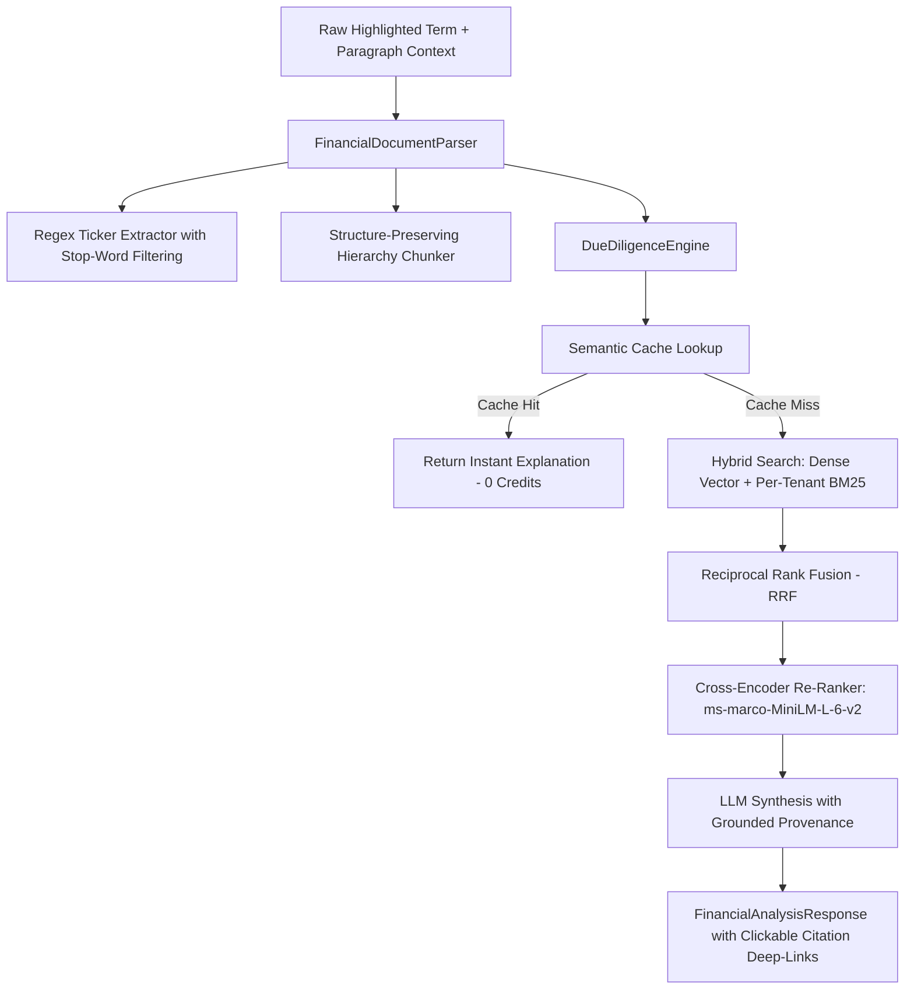

# CASL — Financial Due Diligence RAG Engine Deep Dive

The financial due diligence subsystem (`backend/domains/finance/`) is the core intelligence engine of CASL. It transforms raw DOM text into verified, cited, and actionable intelligence.

---

## 1. Domain Pipeline Architecture



---

## 2. Structure-Aware Document Chunker (`parser.py`)

Generic NLP sentence splitters destroy the semantic coherence of financial agreements by breaking mid-clause or bisecting debt calculation formulas. `FinancialDocumentParser` utilizes structure-aware chunking:

1. **Regulatory Section Boundary Detection**:
   - Detects standard statutory headings (`Item 1A. Risk Factors`, `Item 7. Management's Discussion and Analysis`, `Section 7.02 Negative Pledge`).
   - Ensures chunks do not cross high-level section boundaries.
2. **Contextual Metadata Enrichment**:
   - Every generated chunk carries document title, detected form type (`10-K`, `10-Q`, `8-K`), filing accession number, and chunk character bounds.

---

## 3. Disclosure Ticker Extraction with Stop-Word Filtering

When financial text mentions `(AAPL)` or `(MSFT)`, standard regex matches stock tickers. However, regulatory filings frequently use uppercase words in parentheses such as:
`...under the terms of (FORM) 10-K...` or `...as described in (NOTE) 4...` or `...calculated using (INDEX) values...`.

To eliminate false-positive ticker assignments, `parser.py` enforces a **regulatory stop-word filter**:
```python
DISCLOSURE_STOPWORDS = {
    "FORM", "ITEM", "NOTE", "DEBT", "INDEX", "TABLE", 
    "TOTAL", "ASSET", "CASH", "TERM", "YEAR", "PLAN", "DATE"
}
```
Only valid, non-stopword uppercase symbols (1 to 5 characters) are assigned as active equity tickers.

---

## 4. Grounded Citation Math & Provenance

To guarantee that synthesized answers never hallucinate debt terms or financial figures:
1. Every candidate chunk retrieved from `VectorStore` retains its `source_url`, `filing_accession`, `form_type`, and `section`.
2. The `DueDiligenceEngine` injects candidate chunks into the prompt context with strict citation requirements:
   ```text
   Every factual claim must cite the corresponding source document accession number.
   Do not extrapolate beyond the provided text.
   ```
3. Citations are reconciled against the retrieved passages. The resulting `FinancialCitation` models contain validated deep links directly into SEC EDGAR archive files (`https://www.sec.gov/Archives/edgar/data/...`).

