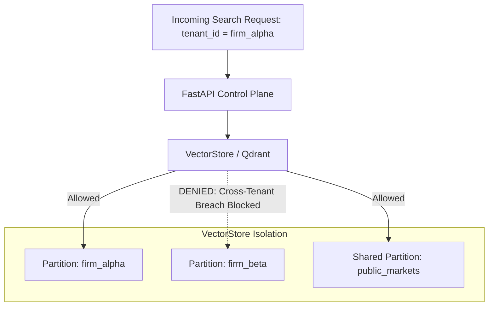
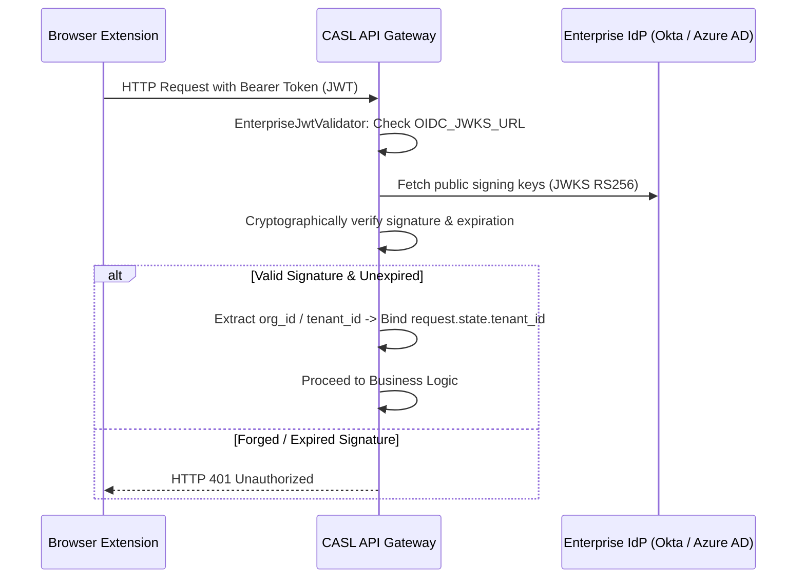

# CASL — Security, Compliance & Multi-Tenant Isolation

This document outlines the security architecture, SOC2-readiness, and tenant boundary enforcement across CASL.

---

## 1. Multi-Tenant Data Isolation

CASL enforces strict data partition isolation. Tenants never share index partitions or BM25 corpora:

1. **Dense Vector Store (`VectorStore._dense`)**:
   - Every embedded point carries an immutable payload attribute: `tenant_id`.
   - Query filters restrict cosine nearest-neighbor search strictly to `tenant_id == request.tenant_id` or `tenant_id == "public_markets"`.
2. **Sparse BM25 Index (`VectorStore._bm25`)**:
   - BM25 corpora are stored in per-tenant dictionaries (`self._corpora[tenant_id]`).
   - Document ID lookups in `document_for_passage(tenant_id, idx)` are bounded strictly to the requesting tenant's slice.

---

## 2. Cryptographic OIDC / RS256 Authentication

CASL supports integration with enterprise Identity Providers (Okta, Auth0, Microsoft Entra ID / Azure AD, Supabase, Clerk).

### Verification Flow

- When `OIDC_JWKS_URL` is configured, `EnterpriseJwtValidator` uses `PyJWKClient` to verify that the token was signed by the enterprise IdP's private RSA key.
- Tokens forged with fabricated base64 claims are rejected automatically.

---

## 3. Secret Hygiene in Manifest V3

In client-side Chrome extensions, all packaged JavaScript can be inspected by users.
- **CASL eliminates client-side secret exposure**:
  - The extension background service worker bundles **zero developer API keys**.
  - All communication routes exclusively through the authenticated enterprise gateway (`POST /api/v1/finance/explain`).
  - Analysts have the option to supply their own personal fallback key via the local Options page (`chrome.storage.local`), ensuring organization credentials are never distributed in extension packages.

