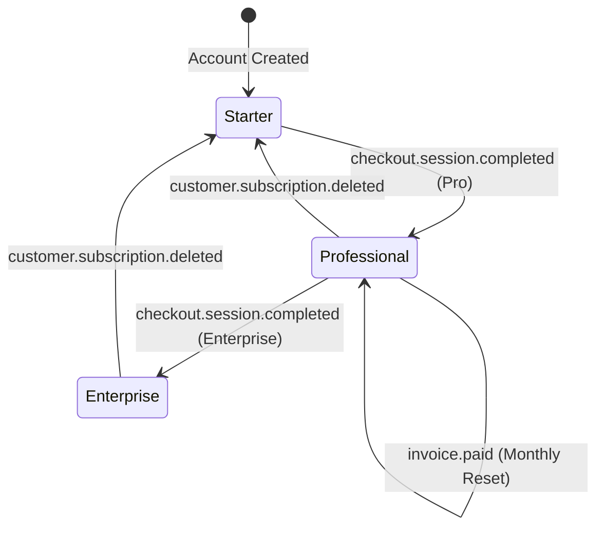

# CASL — Billing, Monetization & Metering Engine

CASL implements an institutional-grade B2B credit metering system designed to prevent API abuse, monetize research volume, and provide accounting-grade auditability.

---

## 1. Plan Tiers & Credit Quotas

Credit allocation is tiered by customer plan:

| Tier | Monthly Price | Monthly Credit Quota | Active Seat Limit | Hard Cap Enforced |
| :--- | :---: | :---: | :---: | :---: |
| **Starter** | $299 / mo | 500 credits | 3 seats | Yes (`HTTP 402`) |
| **Professional** | $1,499 / mo | 5,000 credits | 10 seats | Yes (`HTTP 402`) |
| **Enterprise** | $4,999+ / mo | 50,000 credits | 100+ seats | Custom SLA |

---

## 2. Multi-Replica Atomic Metering (`redis_meter.py`)

In multi-container or autoscaled cloud deployments, in-memory counters fail because replicas do not share state.

CASL solves this with `RedisUsageMeter`:
1. **Atomic Rolling Keys**:
   - Quotas are keyed by tenant and monthly billing window:
     `casl:usage:{tenant_id}:{YYYYMM}`
   - Sets a 35-day Time-To-Live (TTL) to allow end-of-cycle invoicing reconciliation.
2. **Atomic Lua-style Transactions**:
   - Executes atomic increments via `INCRBY`.
   - If `new_used > limit`, immediately executes `DECRBY` to rollback the overage and raises an `HTTP 402 Payment Required` exception.
3. **Cache Hit Incentive (0 Credits)**:
   - When a research query is satisfied via the Semantic Cache, `is_cache_hit=True` is passed to the meter, burning **0 credits**. This aligns customer incentives with cache utilization and minimizes inference costs.

---

## 3. Automated Stripe Webhooks (`stripe_webhook.py`)

CASL automates tenant lifecycle management via Stripe webhooks:

- **`checkout.session.completed`**: Detects enterprise plan metadata and immediately upgrades the tenant subscription in the meter.
- **`invoice.paid`**: Triggers cycle renewal and resets monthly query allowances.
- **`customer.subscription.deleted`**: Reverts tenant to the Starter tier or locks workspace access.

---

## 4. Relational System of Record (`db_models.py`)

While Redis handles real-time sub-millisecond atomic checks, permanent accounting records are stored in PostgreSQL using SQLAlchemy:
- **`TenantAccount`**: Stores company name, stripe customer ID, subscription status, and allocated seats.
- **`CreditAuditLedger`**: Double-entry ledger recording every query burn (`delta = -1`) and subscription provision (`delta = +5000`), ensuring complete auditability for corporate finance teams.

