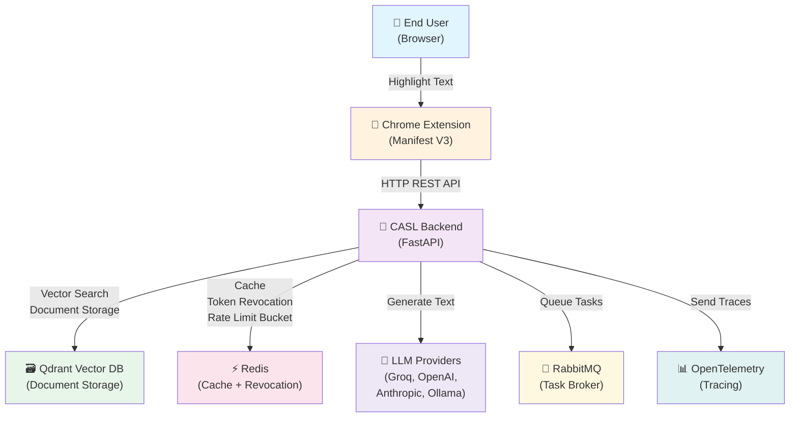
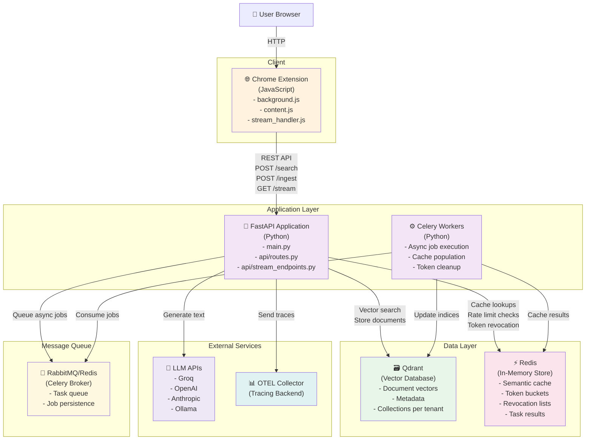
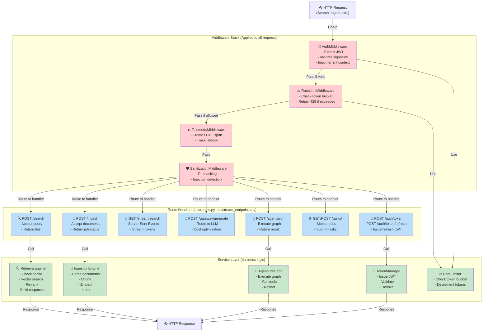
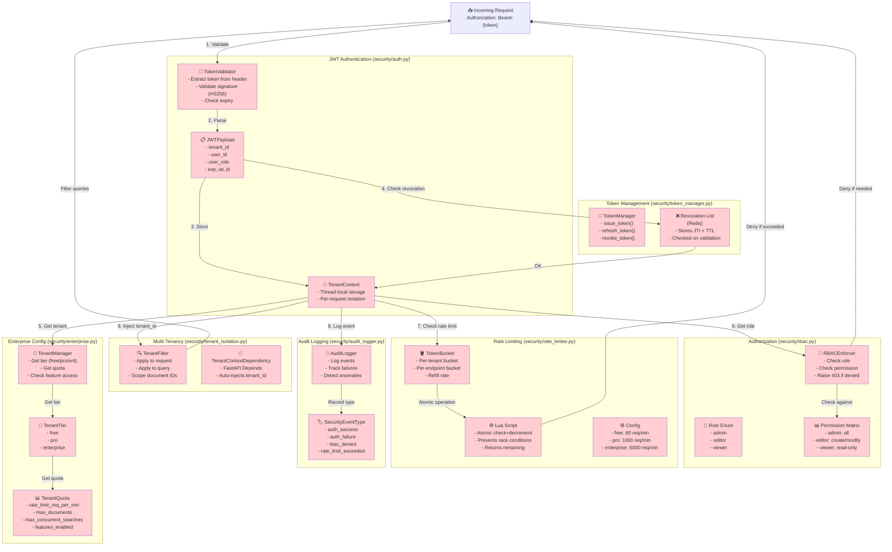
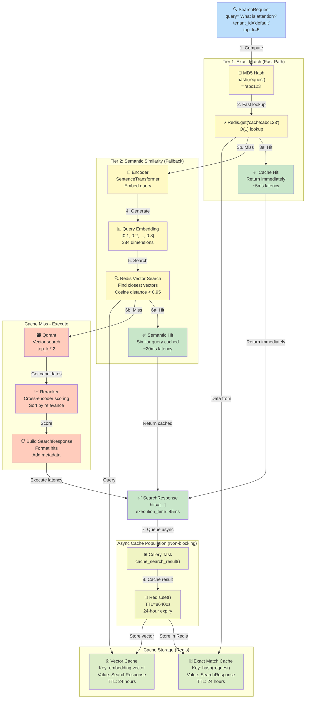
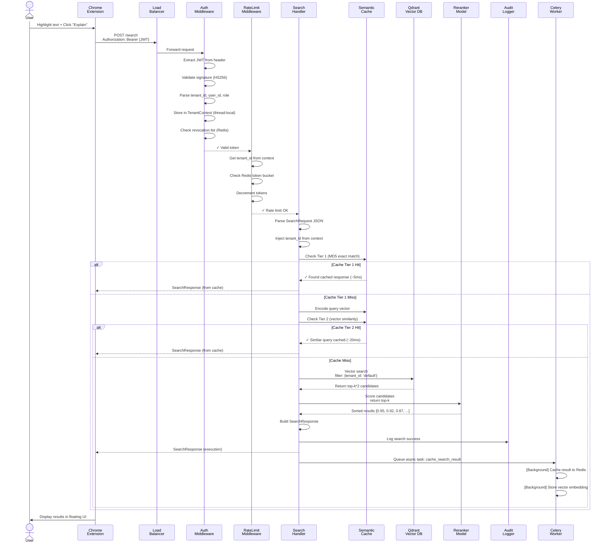
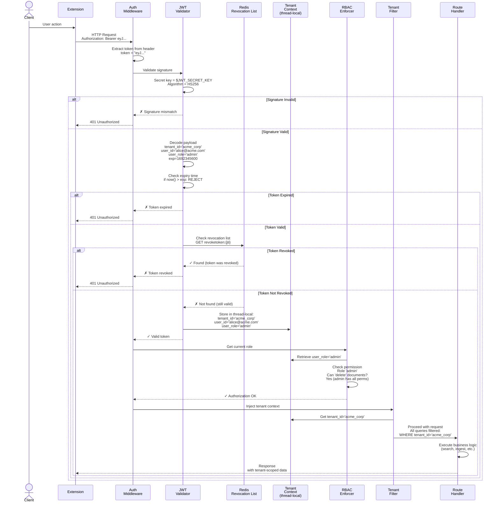
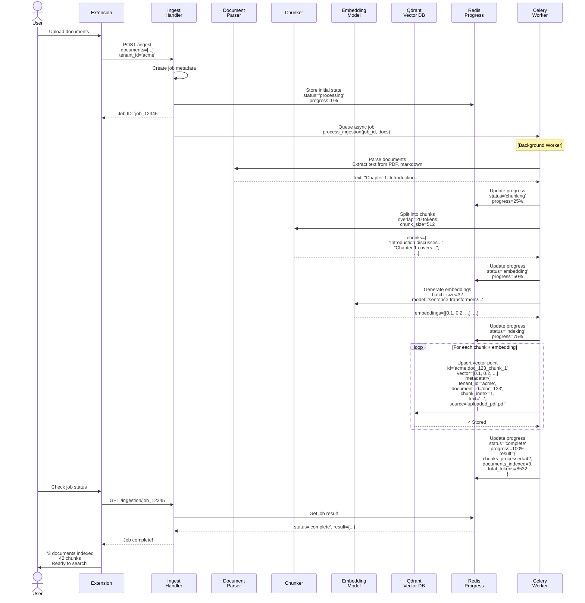

# Architecture Diagrams - Complete Visual Reference

This document contains 10 essential architecture diagrams derived directly from the CASL codebase. Each diagram is followed by:
- **How to read this diagram**
- **Important observations** (architectural insights)
- **Questions to test your understanding**

---

## 1. System Context Diagram

Shows CASL as a system in its environment, with users, external systems, and major data stores.



### How to Read This Diagram

- **Blue box (User)**: End user interacting with Chrome Extension
- **Orange box (Extension)**: Frontend component (Manifest V3 service worker + content script)
- **Purple box (Backend)**: Core CASL application (FastAPI)
- **Green, Pink, Purple boxes**: External services and data stores
- **Arrows**: Interactions showing direction of communication

**Key observation**: The backend is the orchestrator. It receives requests from the extension, queries external services, and manages state across multiple data stores.

### Important Observations

1. **Stateless Backend**: Backend doesn't store anything locally; all state goes to Qdrant, Redis, or external APIs
2. **Multiple Data Stores**: Not a single database. Different stores for different concerns:
   - Qdrant for vector search (documents)
   - Redis for caching and rate limiting buckets
   - LLM providers for inference
   - RabbitMQ for async tasks
3. **Chrome Extension Isolation**: Extension talks only to backend API. No direct access to databases
4. **Tracing is Integrated**: OpenTelemetry ingestion built-in from the start

### Questions to Test Understanding

1. Why doesn't the Chrome Extension talk directly to Qdrant?
2. What's the purpose of Redis vs Qdrant (why not use just one database)?
3. If RabbitMQ goes down, what happens to the system? (Does it crash or degrade gracefully?)
4. What would happen if you removed the OpenTelemetry connection?
5. Why does the backend need to connect to multiple LLM providers instead of just one?

---

## 2. Container Diagram

Shows the major deployable units and their interactions.



### How to Read This Diagram

- **Client box**: Chrome Extension (runs in browser)
- **Application Layer**: FastAPI server and Celery workers (Python application code)
- **Data Layer**: Qdrant and Redis (persistent/cache storage)
- **External Services**: Third-party APIs and tracing
- **Message Queue**: Celery broker for async jobs
- **Arrows**: Dependencies and data flow between containers

### Important Observations

1. **Horizontal Scalability**: 
   - FastAPI instances can be scaled (stateless, no affinity needed)
   - Celery workers can be scaled independently
   - Qdrant and Redis can be clustered

2. **Task Queue Pattern**: 
   - Long-running operations (cache population, ingestion) handled by Celery workers
   - API remains responsive

3. **Async Processing**:
   - FastAPI returns immediately for search
   - Celery worker populates cache in background (non-blocking)

4. **Single Broker**: Both RabbitMQ and Redis can serve as Celery broker
   - Reduces external dependencies if using Redis

### Questions to Test Understanding

1. Why are Celery workers separate from the FastAPI server? (Why not just do everything in FastAPI?)
2. If you scale FastAPI horizontally (add more instances), what else needs to be scaled?
3. What happens if Qdrant is down? (Can users still search? Will it fail immediately or return cached results?)
4. The diagram shows both RabbitMQ and Redis. Why might an operator choose one over the other?
5. How does the trace data flow? Can the system function without OTEL Collector?

---

## 3. Component Diagram - API Layer

Detailed view of the FastAPI application internal components.



### How to Read This Diagram

- **Red boxes (Middleware Stack)**: Applied to every single request (cross-cutting concerns)
- **Blue boxes (Route Handlers)**: Specific endpoints that parse HTTP requests
- **Green boxes (Service Layer)**: Business logic that does actual work
- **Flow**: Request → Middleware chain → Routed to handler → Service layer → Response

### Important Observations

1. **Middleware Chain Execution Order Matters**:
   - Auth must run before rate limiting (need tenant_id)
   - Rate limiting before business logic (fail fast)
   - Telemetry wraps everything (captures latency)

2. **Handler → Service Separation**:
   - Handlers are thin (parse request, call service, return response)
   - Services contain business logic
   - Makes testing and reuse easier

3. **Conditional Middleware**:
   - Some middleware (Auth, RateLimit) only active if `AUTH_ENABLED=true`
   - Others (Telemetry) always active
   - Middleware can be disabled without changing handler code

4. **Not All Handlers Use All Services**:
   - `/search` uses RetrievalEngine
   - `/ingest` uses IngestionEngine
   - `/agents/run` uses AgentExecutor
   - Each has specific responsibilities

### Questions to Test Understanding

1. What happens if AuthMiddleware fails? (Does the request reach the handler or return 401?)
2. If RateLimitMiddleware returns 429, can the handler still execute?
3. Why is the middleware stack applied to ALL requests including `/health` and `/auth/token`?
4. What would happen if you reordered the middleware (moved RateLimit before Auth)?
5. Why separate the middleware from the handler? Why not just put auth checks inside each handler?

---

## 4. Component Diagram - Security Layer

Detailed view of authentication, authorization, and security components.



### How to Read This Diagram

- **Red boxes**: All security components (auth, RBAC, rate limiting, tenant isolation)
- **Flow numbers** (1-9): Order of security processing
- **Subgraphs**: Logical grouping by responsibility

### Important Observations

1. **Layered Security**:
   - JWT validation (is user authentic?)
   - RBAC enforcement (is user authorized?)
   - Rate limiting (has user exceeded quota?)
   - Tenant filtering (only see own data?)
   - Audit logging (track everything)

2. **Thread-Local Context**:
   - All security data stored in `TenantContext`
   - Available to entire request without passing through all functions
   - Cleaned up after request completes

3. **Atomic Rate Limiting**:
   - Lua script ensures check+decrement happens atomically
   - Prevents race conditions between concurrent requests

4. **Optional by Default**:
   - Each security layer can be disabled independently
   - If `AUTH_ENABLED=false`, JWT validation skipped
   - If `RBAC_ENABLED=false`, role checks skipped

5. **Enterprise Tiers**:
   - Different quotas for free/pro/enterprise
   - Overrideable per-tenant via environment

### Questions to Test Understanding

1. Why use thread-local storage for TenantContext instead of passing it through function parameters?
2. What happens if JWT is revoked but still valid? (Cached or checked every time?)
3. Why is the Lua script needed for rate limiting? (What would break without it?)
4. If an admin user hits rate limit, do they skip the limit or get blocked like everyone else?
5. What's the difference between checking revocation list vs checking expiry time in JWT?

---

## 5. Component Diagram - Caching Layer

Detailed view of the two-tier semantic caching system.



### How to Read This Diagram

- **Blue (input/output)**: Request and response
- **Yellow (cache operations)**: Lookups and vector operations
- **Green (hits)**: Fast return paths
- **Orange (miss)**: Fallback to Qdrant + re-ranking
- **Light yellow/green (async)**: Background cache population

### Important Observations

1. **Two-Tier Strategy Reduces Latency**:
   - Exact match: 5ms
   - Semantic similarity: 20ms
   - Full execution: 200-1000ms
   - 95%+ latency reduction for cache hits

2. **Non-Blocking Population**:
   - Handler returns immediately
   - Cache population happens in background (Celery task)
   - Next similar query benefits from cache

3. **Vector Similarity Threshold**:
   - Default: 0.95 cosine distance
   - Tunable via `CACHE_SIMILARITY_THRESHOLD` env var
   - Tradeoff: Higher = fewer false positives, more misses

4. **TTL-Based Cleanup**:
   - All cache entries expire after 24 hours
   - Automatic cleanup (Redis handles)
   - No manual cache invalidation needed

5. **Multi-Tenant Isolation**:
   - Cache keys scoped to tenant_id
   - "Query A from tenant X" ≠ "Query A from tenant Y"

### Questions to Test Understanding

1. Why two tiers instead of just semantic similarity? (What's the benefit of exact match?)
2. If the semantic similarity threshold is too low (e.g., 0.7), what happens? (Too many or too few cache hits?)
3. What happens if the embedding model changes? (Do all cached entries become invalid?)
4. If Redis goes down, does the system crash or degrade gracefully?
5. Why use Celery for cache population instead of doing it synchronously?

---

## 6. Dependency Diagram

Shows which modules depend on which other modules.

```mermaid
graph BT
    Config["core/config.py<br/>Configuration<br/>(env vars)"]
    Encoder["core/encoder.py<br/>Embedding Model<br/>(SentenceTransformer)"]
    
    Auth["security/auth.py<br/>JWT Validation<br/>TenantContext"]
    RBAC["security/rbac.py<br/>Role-based Access"]
    RateLimit["security/rate_limiter.py<br/>Token Bucket"]
    Audit["security/audit_logger.py<br/>Event Logging"]
    TokenMgr["security/token_manager.py<br/>JWT Lifecycle"]
    TenantIso["security/tenant_isolation.py<br/>Multi-tenant Filtering"]
    Enterprise["security/enterprise.py<br/>Tier Management"]
    Monitor_Sec["security/monitor.py<br/>Security Health"]
    
    Middleware["middleware/telemetry.py<br/>OpenTelemetry<br/>Tracing"]
    Sanitizer["middleware/sanitizer.py<br/>PII Masking<br/>Injection Detection"]
    
    Cache["cache/semantic_cache.py<br/>Two-tier Caching"]
    RedisClient["cache/redis_client.py<br/>Redis Connection"]
    CacheMonitor["cache/monitor.py<br/>Cache Metrics"]
    
    VectorStore["db/vector_store.py<br/>Qdrant Integration"]
    Reranker["models/reranker.py<br/>Cross-encoder"]
    
    RetrievalEng["services/retrieval_engine.py<br/>RAG Orchestration"]
    IngestionEng["services/ingestion.py<br/>Document Processing"]
    
    APIRoutes["api/routes.py<br/>REST Endpoints"]
    StreamEndpoints["api/stream_endpoints.py<br/>SSE Streaming"]
    StreamBuilder["api/stream_builder.py<br/>Stream Response"]
    
    Gateway["gateway/router.py<br/>LLM Routing"]
    CircuitBreaker["gateway/circuit_breaker.py<br/>Resilience"]
    Complexity["gateway/complexity.py<br/>Cost Estimation"]
    Providers["gateway/providers/*<br/>Provider APIs"]
    
    Agents["agents/graph.py<br/>LangGraph State"]
    Nodes["agents/nodes.py<br/>Agent Nodes"]
    Safety["agents/safety.py<br/>Safety Checks"]
    
    Tasks["tasks/celery_app.py<br/>Celery Setup"]
    TasksEP["tasks/endpoints.py<br/>Task API"]
    Jobs["tasks/jobs.py<br/>Job Definitions"]
    
    Evals["evals/eval_harness.py<br/>Evaluation"]
    
    Main["main.py<br/>Application<br/>Bootstrap"]
    
    %% Dependencies
    Auth --> Config
    RBAC --> Config
    RateLimit --> Config
    Audit --> Config
    TokenMgr --> Config
    TenantIso --> Auth
    Enterprise --> Config
    Monitor_Sec --> Auth
    
    Cache --> Config
    Cache --> RedisClient
    Cache --> Encoder
    RedisClient --> Config
    CacheMonitor --> Cache
    
    VectorStore --> Config
    Reranker --> Config
    Reranker --> Encoder
    
    RetrievalEng --> Config
    RetrievalEng --> Cache
    RetrievalEng --> VectorStore
    RetrievalEng --> Reranker
    RetrievalEng --> Encoder
    RetrievalEng --> Audit
    RetrievalEng --> TenantIso
    
    IngestionEng --> Config
    IngestionEng --> VectorStore
    IngestionEng --> Encoder
    IngestionEng --> Audit
    
    APIRoutes --> RetrievalEng
    APIRoutes --> IngestionEng
    APIRoutes --> TenantIso
    APIRoutes --> Audit
    
    StreamEndpoints --> Config
    StreamEndpoints --> StreamBuilder
    StreamBuilder --> Gateway
    
    Gateway --> Config
    Gateway --> CircuitBreaker
    Gateway --> Complexity
    Gateway --> Providers
    
    Agents --> Config
    Agents --> Nodes
    Nodes --> Safety
    Nodes --> Gateway
    
    Tasks --> Config
    Jobs --> Cache
    Jobs --> VectorStore
    TasksEP --> Tasks
    
    Middleware --> Config
    Sanitizer --> Config
    
    Evals --> Config
    Evals --> RetrievalEng
    
    Main --> Auth
    Main --> RateLimit
    Main --> APIRoutes
    Main --> Gateway
    Main --> Agents
    Main --> Tasks
    Main --> Middleware
    Main --> Evals
    
    style Config fill:#fff9c4
    style Encoder fill:#fff9c4
    style Auth fill:#ffcccc
    style RBAC fill:#ffcccc
    style RateLimit fill:#ffcccc
    style Audit fill:#ffcccc
    style TokenMgr fill:#ffcccc
    style TenantIso fill:#ffcccc
    style Enterprise fill:#ffcccc
    style Monitor_Sec fill:#ffcccc
    style Cache fill:#ffe0b2
    style RedisClient fill:#ffe0b2
    style CacheMonitor fill:#ffe0b2
    style VectorStore fill:#e1bee7
    style Reranker fill:#e1bee7
    style RetrievalEng fill:#b3e5fc
    style IngestionEng fill:#b3e5fc
    style APIRoutes fill:#c8e6c9
    style StreamEndpoints fill:#c8e6c9
    style StreamBuilder fill:#c8e6c9
    style Gateway fill:#f0f4c3
    style CircuitBreaker fill:#f0f4c3
    style Complexity fill:#f0f4c3
    style Agents fill:#ffccbc
    style Nodes fill:#ffccbc
    style Safety fill:#ffccbc
    style Tasks fill:#c5cae9
    style JobsEP fill:#c5cae9
    style Jobs fill:#c5cae9
    style Middleware fill:#d1c4e9
    style Sanitizer fill:#d1c4e9
    style Evals fill:#ce93d8
    style Main fill:#ff7043
```



### How to Read This Diagram

- **Arrows point upward** (A→B means B depends on A)
- **Color coding**: Each layer/subsystem has its own color
- **Config at bottom**: All modules depend on configuration

### Important Observations

1. **Configuration is Foundation**:
   - `core/config.py` is imported by almost everything
   - Environment variables centralized

2. **No Circular Dependencies**:
   - Architecture is acyclic (DAG)
   - Easier to reason about and test

3. **Layering**:
   - Bottom: Config, Encoder, Data Access (Redis, Qdrant)
   - Middle: Services (Retrieval, Ingestion), Caching, Security
   - Top: API routes, Endpoints
   - Peak: main.py orchestrates everything

4. **Independent Subsystems**:
   - Agents (Nodes, Safety) can work independently
   - Evaluation (Evals) minimal dependencies
   - Task queue (Celery) loosely coupled

5. **High Fan-In at Services Level**:
   - `RetrievalEng` depends on: Cache, VectorStore, Reranker, Encoder, Audit, TenantIso
   - This is appropriate (central business logic)

### Questions to Test Understanding

1. Why does almost every module depend on `core/config.py`?
2. What would happen if you removed the dependency from `RetrievalEng` → `Cache`?
3. Can `Agents` module work without `Gateway` module? (What would you lose?)
4. Why is there no dependency from `APIRoutes` → `Security`? (Where does auth happen?)
5. If you want to add a new feature, where would you add it to minimize dependencies?

---

## 7. Request Lifecycle - Search Request

Traces a `/search` request from client to response, showing what happens at each layer.



### How to Read This Diagram

- **Participants**: Each column represents a component
- **Arrows (→)**: Synchronous calls (wait for response)
- **Dashed arrows (-->>)**: Async responses or results
- **Boxes**: Logic that happens inside a component
- **Alt blocks**: Alternative paths (cache hit vs miss)

### Important Observations

1. **Fail-Fast Design**:
   - Auth and rate limit checked first
   - Return error immediately if invalid
   - Prevents wasted computation

2. **Cache Layering Reduces Latency**:
   - 5ms for exact match (Tier 1)
   - 20ms for semantic match (Tier 2)
   - 200-1000ms for full execution
   - Huge win for repeat queries

3. **Non-Blocking Cache Population**:
   - Response returned immediately
   - Cache update happens in background (Celery worker)
   - Next similar query benefits

4. **Async Audit Logging**:
   - Search logged synchronously (audit/compliance)
   - But doesn't block response
   - Could be optimized to async if latency-critical

5. **Tenant Isolation at Vector DB**:
   - Filter by tenant_id at Qdrant query time
   - Double-blind: JWT claim + DB filter

### Questions to Test Understanding

1. What happens if the JWT signature is invalid? (At which step does it fail?)
2. If a tenant is rate-limited, how long do they have to wait before trying again?
3. Why cache both the request hash and the query embedding? (What's the difference?)
4. If Qdrant returns 100 results, why re-rank them? (Why not just return top-10?)
5. What would happen if you removed the async cache population and made it synchronous?

---

## 8. Authentication & Authorization Flow

Detailed flow of JWT validation, RBAC checks, and tenant isolation.



### How to Read This Diagram

- **AuthMW → Handler path**: Happy path (all checks pass)
- **Alt blocks**: Error conditions (401 responses)
- **Context (thread-local)**: Stores security info for request lifetime
- **Redis**: External revocation list check

### Important Observations

1. **Multi-Step Validation**:
   - Signature check (is it from us?)
   - Expiry check (is it still valid?)
   - Revocation check (has it been manually revoked?)
   - Role check (is user authorized for this action?)

2. **Stateless Authentication**:
   - No session storage
   - Token contains all needed info (tenant_id, user_id, role)
   - Only revocation list stored externally (for manual revocation)

3. **Thread-Local Context**:
   - Once validated, token info stored in `TenantContext`
   - Available to all code in request
   - No need to pass tenant_id through all functions

4. **Automatic Tenant Filtering**:
   - After auth, all queries automatically filtered
   - User from 'acme_corp' can never see data from 'other_corp'
   - Double-blind: JWT claim + database filter

5. **Optional Security**:
   - If `AUTH_ENABLED=false`, auth middleware skipped
   - If `RBAC_ENABLED=false`, role checks skipped
   - Request still gets default tenant_id

### Questions to Test Understanding

1. Why check both signature AND expiry? (Why not just rely on signature?)
2. What's the difference between an expired token and a revoked token?
3. If JWT_SECRET_KEY changes, what happens to existing tokens? (Are they all invalid?)
4. Can a user from 'acme_corp' ever see data from 'default' tenant? (Design prevents it?)
5. What would happen if you stored tenant_id only in the JWT and not in TenantContext?

---

## 9. Sequence Diagram - Document Ingestion Flow

Traces document upload, chunking, embedding, and indexing.



### How to Read This Diagram

- **Main thread**: Ingest handler (returns job ID immediately)
- **Worker thread**: Celery worker processes asynchronously
- **Redis**: Stores progress/state for status polling
- **Qdrant**: Persists vectors with metadata

### Important Observations

1. **Async Job Processing**:
   - Ingest endpoint returns immediately with job ID
   - User can check status via polling
   - Heavy lifting (embedding, indexing) in background

2. **Progress Tracking**:
   - Each step updates Redis with percentage
   - User can see real-time progress

3. **Multi-Tenant Scoping**:
   - Document IDs scoped: `acme:doc_123_chunk_1`
   - Tenant stored in metadata
   - Prevents cross-tenant access

4. **Batch Processing**:
   - Embeddings generated in batches (32 at a time)
   - More efficient than one-at-a-time
   - Qdrant upserts batched too

5. **Idempotent Upserts**:
   - If same chunk uploaded twice
   - ID is same → vector is updated (not duplicated)

### Questions to Test Understanding

1. Why split ingestion into async job instead of blocking the request?
2. What happens if the embedding model fails halfway through? (Are partially indexed documents lost?)
3. How does Qdrant know to filter by tenant_id when searching? (Is it in the vector or metadata?)
4. Why chunk documents at all? (Why not just index whole documents?)
5. If a user uploads the same document twice, do they get duplicate vectors?

---

## 10. Deployment Architecture

Shows how CASL is deployed: clients, servers, databases, infrastructure.

```mermaid
graph TB
    subgraph "Client Tier"
        Browser["🌐 User's Browser"]
        Extension["🔌 Chrome Extension<br/>(Manifest V3)"]
    end
    
    subgraph "CDN / Static Hosting (Optional)"
        CDN["📦 CDN<br/>(extension.js<br/>manifest.json)"]
    end
    
    subgraph "API Tier (Kubernetes or VMs)"
        LB["⚖️ Load Balancer<br/>(nginx/HAProxy)"]
        API1["🔧 FastAPI Instance 1<br/>- auth.py<br/>- routes.py<br/>- services/"]
        API2["🔧 FastAPI Instance 2"]
        API3["🔧 FastAPI Instance N"]
    end
    
    subgraph "Worker Tier (Celery)"
        Worker1["⚙️ Celery Worker 1<br/>- Cache population<br/>- Ingestion<br/>- Token cleanup"]
        Worker2["⚙️ Celery Worker 2"]
        WorkerN["⚙️ Celery Worker N"]
    end
    
    subgraph "Message Queue"
        RabbitMQ["📨 RabbitMQ/Redis<br/>(Task Broker)<br/>- Job queue<br/>- Task persistence"]
    end
    
    subgraph "Data Tier"
        Qdrant_Main["🗃️ Qdrant Primary<br/>(Vector DB)"]
        Qdrant_Replica["🗃️ Qdrant Replica<br/>(Read-only)"]
        Redis_Main["⚡ Redis Primary<br/>(Cache)"]
        Redis_Replica["⚡ Redis Replica<br/>(Read-only)"]
    end
    
    subgraph "Monitoring & Observability"
        Prometheus["📊 Prometheus<br/>(Metrics)"]
        Jaeger["🔍 Jaeger<br/>(Traces)"]
        AlertManager["🚨 AlertManager<br/>(Alerts)"]
        Grafana["📈 Grafana<br/>(Dashboards)"]
    end
    
    subgraph "External Services"
        LLM_APIs["🤖 LLM APIs<br/>- Groq<br/>- OpenAI<br/>- Anthropic<br/>- Ollama"]
        OTEL["📡 OTEL Collector<br/>(receives traces)"]
    end
    
    subgraph "CI/CD Pipeline"
        GitHub["🐙 GitHub<br/>(Source Code)"]
        GHActions["⚡ GitHub Actions<br/>- Build Docker image<br/>- Run tests<br/>- Push to registry"]
        Registry["📦 Docker Registry<br/>(ECR/Dockerhub)<br/>- casl:v1.0.0<br/>- casl:latest"]
    end
    
    Browser -->|1. Install extension| Extension
    Extension -->|2. Click 'Explain'| LB
    
    LB -->|3. Round-robin| API1
    LB -->|3. Round-robin| API2
    LB -->|3. Round-robin| API3
    
    API1 -->|4. Cache/revocation| Redis_Main
    API1 -->|5. Vector search| Qdrant_Main
    API1 -->|6. Queue job| RabbitMQ
    API1 -->|7. Send trace| OTEL
    API1 -->|8. Call LLM| LLM_APIs
    
    RabbitMQ -->|Consume| Worker1
    RabbitMQ -->|Consume| Worker2
    RabbitMQ -->|Consume| WorkerN
    
    Worker1 -->|Update cache| Redis_Main
    Worker1 -->|Index vectors| Qdrant_Main
    
    Redis_Main -->|Replication| Redis_Replica
    Qdrant_Main -->|Replication| Qdrant_Replica
    
    API1 -->|Read (optional)| Redis_Replica
    API1 -->|Read (optional)| Qdrant_Replica
    
    API1 -->|Emit metrics| Prometheus
    OTEL -->|Export traces| Jaeger
    Prometheus -->|Alert on| AlertManager
    Prometheus -->|Display| Grafana
    Jaeger -->|Visualize| Grafana
    
    GitHub -->|Webhook| GHActions
    GHActions -->|Push image| Registry
    Registry -->|Pull image| API1
    Registry -->|Pull image| Worker1
    
    style Browser fill:#e3f2fd
    style Extension fill:#fff3e0
    style LB fill:#f3e5f5
    style API1 fill:#f3e5f5
    style API2 fill:#f3e5f5
    style API3 fill:#f3e5f5
    style Worker1 fill:#c8e6c9
    style Worker2 fill:#c8e6c9
    style WorkerN fill:#c8e6c9
    style RabbitMQ fill:#fff8e1
    style Qdrant_Main fill:#e8f5e9
    style Qdrant_Replica fill:#e8f5e9
    style Redis_Main fill:#fce4ec
    style Redis_Replica fill:#fce4ec
    style Prometheus fill:#bbdefb
    style Jaeger fill:#bbdefb
    style AlertManager fill:#bbdefb
    style Grafana fill:#bbdefb
    style LLM_APIs fill:#ede7f6
    style GitHub fill:#f5f5f5
    style GHActions fill:#f5f5f5
    style Registry fill:#f5f5f5
```

### How to Read This Diagram

- **Client Tier (top)**: End user browser with Chrome Extension
- **API Tier**: Multiple FastAPI instances behind load balancer
- **Worker Tier**: Celery workers consume jobs from queue
- **Data Tier**: Qdrant and Redis with replicas
- **Observability**: Monitoring and tracing infrastructure
- **CI/CD**: Automated deployment pipeline
- **Arrows**: Request/data flow between components

### Important Observations

1. **Horizontal Scalability**:
   - API instances stateless (can scale freely)
   - Celery workers independent (can scale separately)
   - Load balancer distributes requests
   - Both Qdrant and Redis can cluster

2. **High Availability**:
   - Multiple API instances (no single point of failure)
   - Multiple Celery workers
   - Redis replication for failover
   - Qdrant replication for read-heavy queries

3. **Separation of Concerns**:
   - API tier: Request handling
   - Worker tier: Async processing
   - Data tier: Storage
   - Monitoring: Observability

4. **CI/CD Integration**:
   - Code changes trigger automatic build
   - Docker images pushed to registry
   - Kubernetes/VMs pull and deploy automatically

5. **External Dependencies**:
   - LLM APIs called from API tier (not workers)
   - OpenTelemetry collector separate service
   - Prometheus for metrics scraping

### Questions to Test Understanding

1. Why replicate Qdrant and Redis? (Can't the API tier just re-query on failure?)
2. If a Celery worker crashes mid-task, what happens? (Is the job lost or re-queued?)
3. What's the purpose of a load balancer if FastAPI is stateless?
4. Why call LLM APIs from API tier (high latency) instead of async workers?
5. If Prometheus is down, does the system crash or just lose metrics?

---

## Summary: How to Read These Diagrams

### For System Context (Diagram 1)
- Identifies all external systems and actors
- Shows dependencies on external services
- Use when: "What are the boundaries of this system?"

### For Container Architecture (Diagram 2)
- Shows major deployable units
- Shows infrastructure components
- Use when: "How is this deployed? What services does it depend on?"

### For Component Details (Diagrams 3-4)
- Shows internal structure of major subsystems
- Shows intra-subsystem dependencies
- Use when: "How does feature X work internally?"

### For Request Flows (Diagrams 7-9)
- Shows request processing step-by-step
- Shows decision points and error handling
- Use when: "What happens when user does X?"

### For Architecture Decisions (All diagrams)
- Each diagram reveals design choices
- Ask: "Why was it done this way? What are the tradeoffs?"

---

## Key Architectural Insights Revealed by Diagrams

1. **Multi-tier architecture**: Separation between API, workers, data stores
2. **Middleware chain**: Cross-cutting concerns (auth, rate limiting, tracing)
3. **Async processing**: Non-blocking request handling via Celery
4. **Two-tier caching**: Exact match + semantic similarity
5. **Tenant isolation**: Enforced at JWT + database layer
6. **Stateless API**: Can scale horizontally without affinity
7. **Circuit breaker**: Resilience for external API calls
8. **Structured logging**: OpenTelemetry tracing built-in
9. **Batch processing**: Embeddings and indexing optimized
10. **Optional features**: Security and caching can be disabled

---

## Questions to Deepen Understanding

After reviewing all diagrams:

1. **If I add a new endpoint**, where does it go and what dependencies does it need?
2. **If I want to support 1 million users**, which components need to scale? (API? Workers? Qdrant? Redis?)
3. **If an external LLM API goes down**, does CASL stop working or degrade gracefully?
4. **If I want to implement feature X**, which layers does it touch?
5. **What's the minimal deployment** (fewest services) that still works?
6. **What's the maximum latency** for a cached search? For a full execution search?
7. **Where is data most at risk** of cross-tenant leakage?
8. **Where are the bottlenecks** if query volume increases 10x?
9. **How would you test** that tenant isolation works correctly?
10. **What would happen if** you removed each major component?

---

## Next Steps

- Print or bookmark these diagrams
- Reference them while reading the code
- Sketch modifications: "What would change if we added X feature?"
- Use as communication tool: "Here's how a request flows through the system"

Good luck! 🚀
